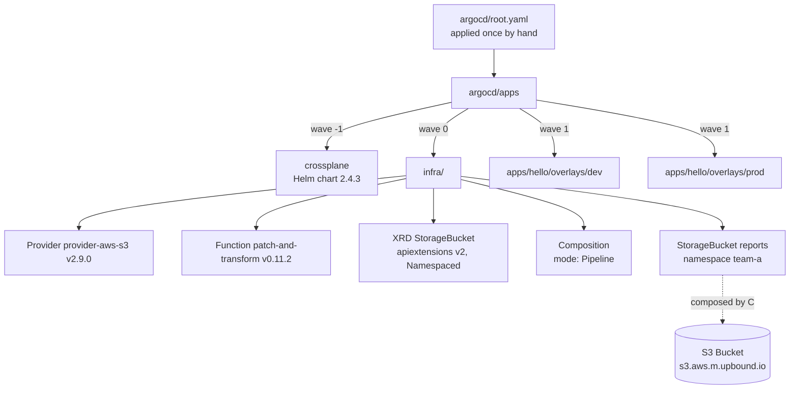

# GitOps monorepo: Argo CD + Crossplane for infra and apps

One repository that Argo CD watches to manage both cloud infrastructure
(through Crossplane) and an application (through Kustomize). A single root
Argo CD Application points at everything else.

> **Status:** this is the minimum that stands up and validates. Every
> manifest is rendered with `kustomize build` and checked with
> `kubeconform -strict` against pinned, checksum-verified schemas, and five
> negative cases must be rejected. **Nothing has been applied to a
> cluster**: no Argo CD sync, no Crossplane reconcile, no S3 bucket created.
> Not built: AWS credentials (`ClusterProviderConfig`), Argo CD installation,
> a CI step that runs a real cluster, and the schema check of the
> function-patch-and-transform input (see Limits).

## Problem

> Create a full GitOps pipeline (Argo CD + Terraform Controller or
> Crossplane) that manages both infrastructure and applications from a
> single monorepo.

Crossplane was chosen over the Terraform Controller: infrastructure becomes
plain Kubernetes objects, so Argo CD treats infra and apps the same way.

## Layout and flow



```
argocd/root.yaml            root Application -> argocd/apps
argocd/apps/                crossplane (Helm), infra, hello-dev, hello-prod
infra/                      Provider, Function, XRD, Composition, StorageBucket XR
apps/hello/base/            Deployment + Service
apps/hello/overlays/{dev,prod}
scripts/sources.lock        every download with its sha256
scripts/fetch.py            download, verify, convert CRDs to JSON schema
scripts/validate.sh         kustomize build | kubeconform -strict, negative cases
tests/negative/             manifests that must be rejected
```

## Crossplane version and composition style

Checked against the Crossplane docs for v2.4 (crossplane/docs,
`content/v2.4`) on 2026-11-20:

- **Crossplane 2.4.3** (Helm chart `2.4.3`).
- **Composition functions, not native patch-and-transform.** Crossplane v2
  only accepts `mode: Pipeline`; the old `mode: Resources` style is gone.
  The Composition runs `function-patch-and-transform` v0.11.2. A negative
  test confirms the v2.4 Composition schema rejects `mode: Resources`.
- **Namespaced XR instead of a claim.** XRDs use
  `apiextensions.crossplane.io/v2` with `scope: Namespaced`, the docs'
  default and recommendation. Claims only exist for `LegacyCluster` XRDs
  (v1 compatibility). So the "claim" a team writes is the namespaced
  `StorageBucket` in `infra/bucket-xr.yaml`.
- **Namespaced managed resource:** `s3.aws.m.upbound.io/v1beta1` `Bucket`
  from `xpkg.crossplane.io/crossplane-contrib/provider-aws-s3:v2.9.0`. v2.10.0
  was released hours before this was written, so the previous release is
  pinned.

This is version-dependent. On Crossplane v1.x the same API would use a v1
XRD with `claimNames`, and native patch-and-transform was still allowed.

## Validation

```bash
python -m pip install -r requirements.txt
python scripts/fetch.py      # pinned downloads, sha256 checked, schemas built
bash scripts/validate.sh     # needs Linux: it runs the linux-amd64 binaries
```

CI runs exactly these. On Windows or macOS, run them in a Linux container,
for example `docker run --rm -v "$PWD:/repo" -w /repo python:3.12-slim bash -c
"pip install -r requirements.txt && python scripts/fetch.py && bash scripts/validate.sh"`.

What happens:

1. `fetch.py` downloads kustomize v5.8.3, kubeconform v0.8.0, the Crossplane
   v2.4.3 CRDs, the Argo CD v3.6.2 Application CRD, and Kubernetes 1.34
   JSON schemas from a pinned commit. Every file is checked against
   `scripts/sources.lock`; a mismatch stops the run.
2. CRDs and this repo's own XRD are turned into JSON schemas with
   `additionalProperties: false` on every object that declares properties
   (except `x-kubernetes-preserve-unknown-fields`), so unknown fields fail
   just like kubeconform's strict Kubernetes schemas.
3. `validate.sh` builds each Kustomize root and runs `kubeconform -strict`
   with **only** the local schema directory. There is no
   `-ignore-missing-schemas`: a kind without a schema is an error.
4. Each file in `tests/negative/` must fail, with the message named on its
   first line: an unknown XR field, a bad cost-centre pattern, a string
   `replicas`, a kind with no schema, and a v1-style `mode: Resources`
   Composition.

## Limits

- **Nothing applied.** No cluster, no Argo CD, no AWS account was used.
- No `ClusterProviderConfig` or AWS credentials. In a real setup that would
  use IRSA or EKS Pod Identity.
- The function input inside the Composition (`pt.fn.crossplane.io` Resources
  and the embedded `Bucket` base) is not schema-checked: the Composition CRD
  marks it as free-form, and no schema is vendored for the function input
  or the provider's `Bucket`.
- Sync waves between child Applications order their creation, but Argo CD
  does not wait for a child Application to be healthy unless a health check
  for `Application` is configured in `argocd-cm`. That config is not
  included.
- Argo CD itself must already be installed; `argocd/root.yaml` is applied
  once by hand.
- `targetRevision: main` everywhere; a real setup might pin tags per
  environment.
- The app image is pinned by tag, not digest.

## Security notes

- No secrets in the repo; the provider has no credentials here.
- The app runs as non-root with dropped capabilities and a RuntimeDefault
  seccomp profile.
- `prune: true` on every Application means deleting a file deletes the
  object, including the S3 bucket's XR. Consider a deletion policy of
  `Orphan` on the bucket before using this with real data.

## Idempotency

Argo CD and Crossplane both reconcile to the declared state, so re-syncing
an unchanged repo changes nothing. Validation is read-only and repeatable;
downloads are cached by hash under `.cache/`.
